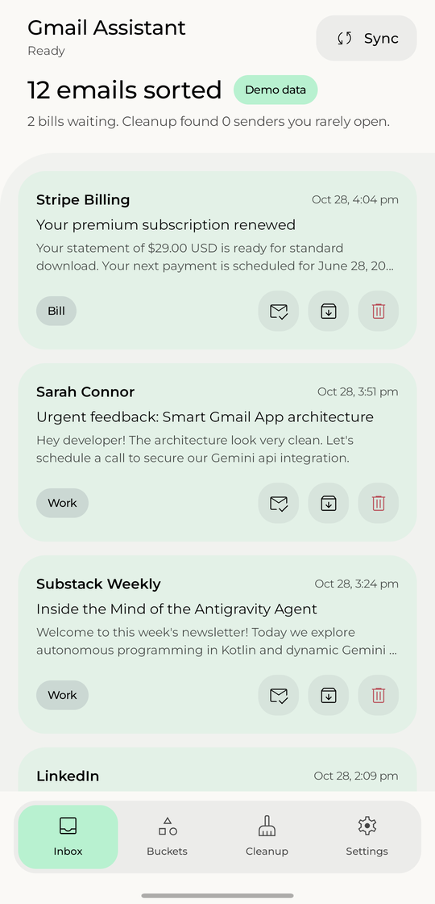
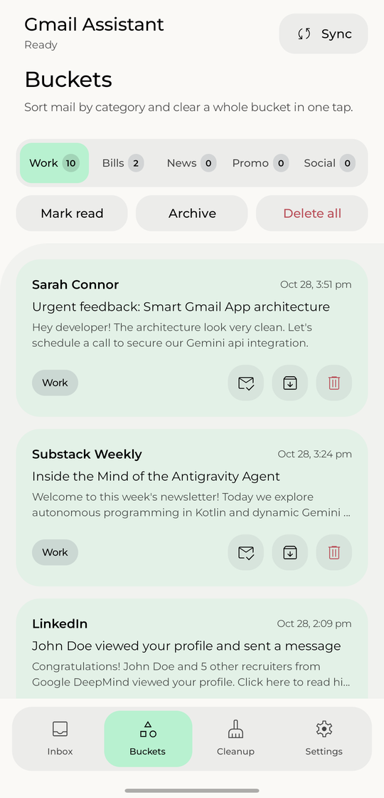
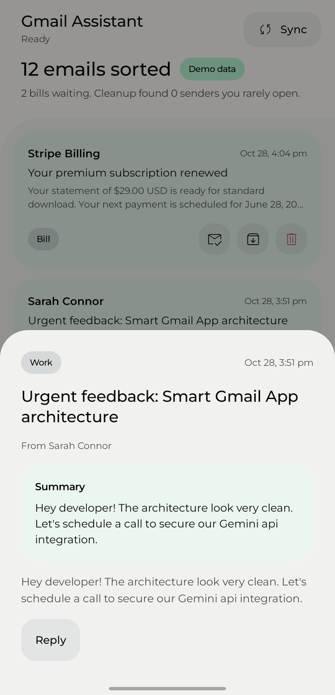
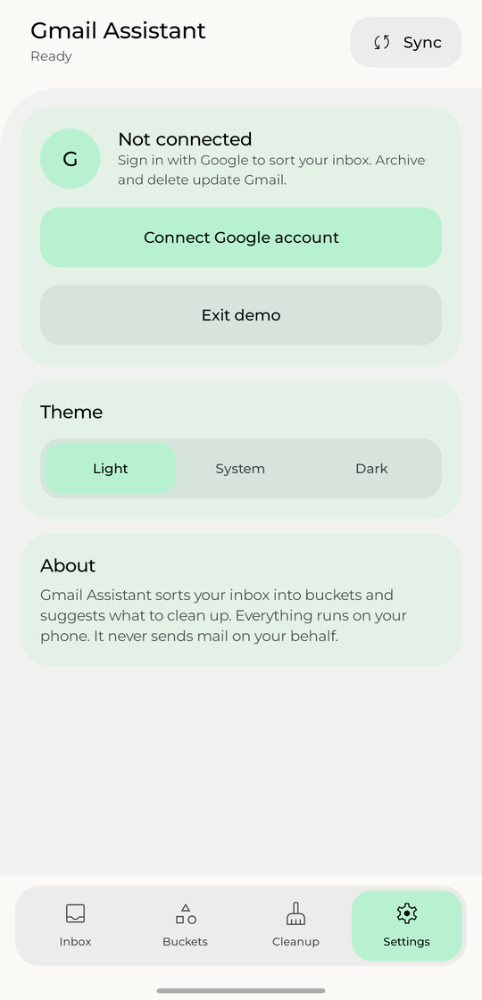
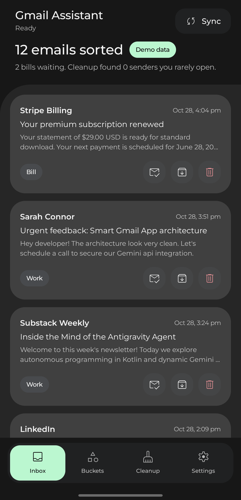
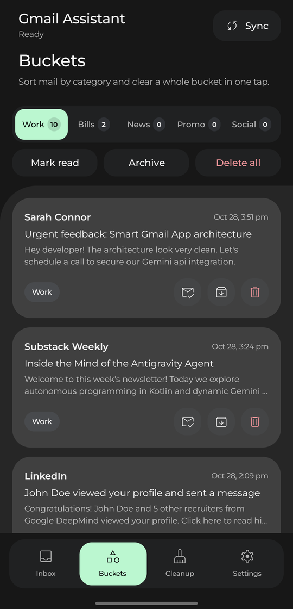
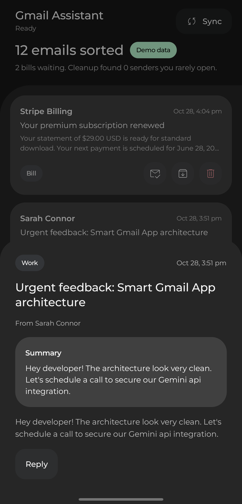
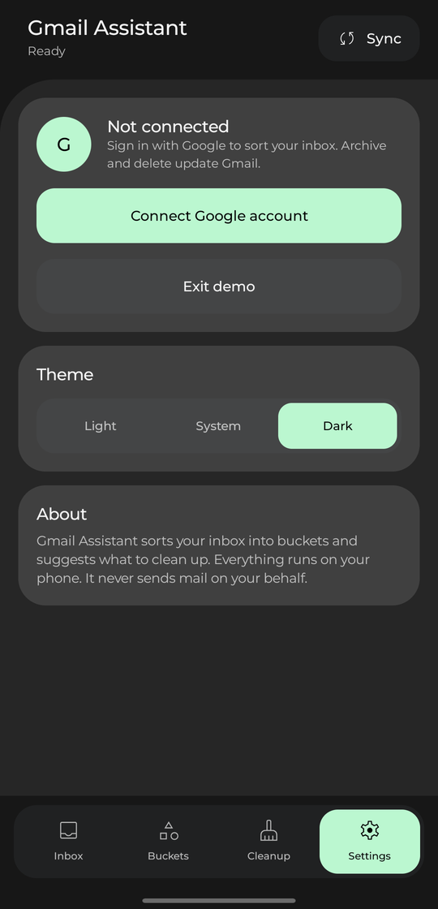
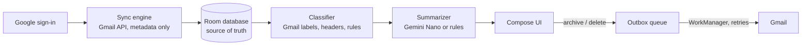

<h1 align="center">Gmail Assistant</h1>

  <strong>Sort your Gmail inbox into buckets and clear a whole bucket in one tap.</strong> 
  Everything runs on your phone. No server, no cloud AI, no API keys.

  
  
  
  

Most inboxes fill up with receipts, newsletters, social alerts and promotions that bury the few emails you need to read. Gmail Assistant reads your inbox, puts every email into a bucket, and lets you archive, delete or mark a whole bucket as read with one button.

What you can do:

- See your inbox sorted into Work, Bills, News, Promo and Social.
- Mark read, archive or delete an entire bucket at once.
- Find senders you rarely open and clear low-priority clutter in bulk.
- Read a short summary of any email without opening it.
- Keep working offline. Actions reach Gmail when the phone is back online.

**Your actions change the real Gmail inbox.** Archive an email in the app and it is archived in Gmail.

---

## Screenshots

<table>
  <tr>
    <td align="center" width="25%"> Inbox</td>
    <td align="center" width="25%"> Buckets</td>
    <td align="center" width="25%"> Email summary</td>
    <td align="center" width="25%"> Settings</td>
  </tr>
  <tr>
    <td align="center"> Inbox, dark</td>
    <td align="center"> Buckets, dark</td>
    <td align="center"> Email summary, dark</td>
    <td align="center"> Settings, dark</td>
  </tr>
</table>

---

## Features

| Feature | What it does |
|---|---|
| Buckets | Each email lands in Work, Bills, News, Promo or Social. Every bucket shows a count and three bulk actions: Mark read, Archive, Delete all. |
| Cleanup | Lists senders you rarely open as unsubscribe suggestions, and low-priority clutter you can archive in bulk. |
| Summaries | A short summary for each email. Phones that support Gemini Nano generate it on the device. Other phones get a rule-based summary that picks out amounts and due dates. |
| Offline use | Emails live in a local database. Archive and delete apply in the app immediately and sync to Gmail later. |
| Background sync | A periodic job keeps the inbox fresh. After the first sync, only changes are fetched. |
| Themes | Light, Dark or follow the system. |
| Demo mode | Tap **Try demo** to explore with sample emails and no Google account. Demo data is labeled and never replaces real data when a sync fails. |

---

## Privacy

- Mail data stays in the app's database on your phone.
- The database and preferences are excluded from Android cloud backup and device transfer.
- The only network traffic goes to Google's Gmail API. There is no analytics, no third-party server and no cloud AI.
- The app reads sender, subject, date, labels and the short snippet. It does not download message bodies.
- The app never sends mail on your behalf.

Details are in [SECURITY.md](SECURITY.md).

---

## How it works

1. You sign in with Google and grant the `gmail.modify` permission, which lets archive and delete change your inbox. The access token is requested when needed and is never stored.
2. The first sync downloads your latest inbox messages. Later syncs fetch only what changed.
3. Each email is classified on the device, starting with Gmail's own category labels, then mail headers and sender and subject patterns.
4. Your actions are saved locally first, then queued and sent to Gmail with retries. Your read, archived and manual-category state survives every sync.

The full design is in [ARCHITECTURE.md](ARCHITECTURE.md).

---

## Getting started

1. Download the APK and open it on an Android 7.0 or newer phone. Android asks you to allow installs from your browser or file manager the first time.
2. Open the app and tap **Settings, then Try demo** to look around with sample emails.
3. To use your own inbox, tap **Connect Google account** and approve the Gmail permission.

`gmail.modify` is a restricted Google permission. Until the app passes Google's verification, only Google accounts that the maintainer has added as test users can connect. Demo mode works for everyone.

Want to build it yourself? See [BUILD.md](BUILD.md).

---

## Limits

- Gmail only.
- The app works on recent inbox mail and does not clone your whole mailbox.
- Reading and organizing only. No composing or sending.
- Gemini Nano summaries need Android 8.0 (API 26) or newer and a supported phone. Other phones use rule-based summaries.

---

## Contributing

Issues and pull requests are welcome. Read [CONTRIBUTING.md](CONTRIBUTING.md) first, and follow the [Code of Conduct](CODE_OF_CONDUCT.md). To report a vulnerability, see [SECURITY.md](SECURITY.md).

Current progress and open work are tracked in [PROGRESS.md](PROGRESS.md).

## License

MIT. See [LICENSE.md](LICENSE.md).
